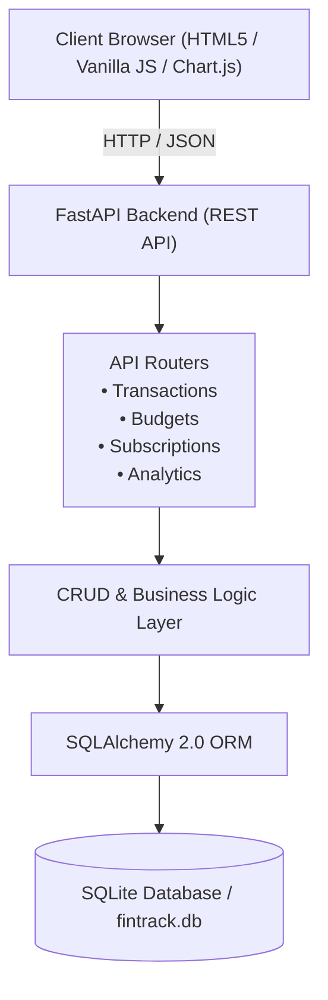

<div align="center">

# 💰 FinTrack Pro
### Modern Personal Finance & Expense Analytics Platform

[](https://www.python.org/)
[](https://fastapi.tiangolo.com/)
[](https://www.sqlalchemy.org/)
[](https://www.chartjs.org/)
[](tests/)
[](LICENSE)

*A full-stack, real-world personal finance application built with Python (FastAPI), SQLAlchemy, modern responsive HTML5/CSS, Chart.js, and SQLite.*

[Features](#-key-features) • [Architecture](#-architecture) • [Quickstart](#-quickstart-guide) • [API Documentation](#-api-endpoints) • [Running Tests](#-running-tests) • [Docker Deployment](#-docker-deployment)

</div>

---

## 🌟 Overview

Managing personal finances shouldn't require complex spreadsheets or fragmented tools. **FinTrack Pro** provides a clean, unified dashboard for tracking daily income and expenses, monitoring category budgets with real-time visual threshold warnings, managing recurring subscriptions with one-click payment logging, and visualizing financial velocity with interactive analytics charts.

---

## ✨ Key Features

- **📊 Real-Time Financial Overview:**
  - Net Balance, Monthly Income, Monthly Expenses, and Daily Burn Rate calculation.
  - Net Savings and Savings Rate percentage metric cards.
  - Multi-currency switcher (`$`, `€`, `£`, `₹`, `¥`).

- **🎯 Monthly Category Budgets & Smart Alerts:**
  - Set custom spending limits per category (e.g., Food & Dining, Rent, Entertainment).
  - Dynamic progress bars with automatic color coding:
    - 🟢 Normal (`< 80%`)
    - 🟡 Warning threshold (`80% - 99%`)
    - 🔴 Budget Exceeded (`>= 100%`)
  - Real-time alert notifications banner for categories nearing or exceeding limits.

- **🔄 Recurring Subscriptions & Fixed Bills Tracker:**
  - Track services (Netflix, Spotify, Gym, AWS, Rent, Health Insurance).
  - Weekly, Monthly, and Yearly billing cycles with automatic monthly cost normalization.
  - Next renewal countdown and **1-Click "Pay"** button to log subscription renewals directly into your transactions.

- **📈 Visual Analytics & Insights (Powered by Chart.js):**
  - **Category Breakdown:** Interactive Doughnut chart showing expense distribution.
  - **6-Month Financial Trend:** Grouped Bar chart contrasting Income vs. Expenses over time.
  - **Daily Spending Velocity:** Smooth line chart illustrating day-to-day spending flow.

- **📝 Complete Transaction Management:**
  - Full CRUD (Create, Read, Update, Delete) with validation.
  - Filter by transaction type (Income / Expense), category, date range, and instant live search.
  - One-click **CSV Export** for record-keeping and external spreadsheet analysis.

- **🎨 Modern Responsive UI:**
  - Built-in Dark Mode and Light Mode with persistent preference memory.
  - Glassmorphism touches and mobile-responsive layout.
  - Zero Node.js / NPM build pipeline required — runs out-of-the-box in any Python environment!

- **⚡ 1-Click Demo Data Generator:**
  - Includes a sample seeder (`POST /api/analytics/seed-demo` or `python seed_demo.py`) that pre-populates 3 months of realistic transactions, budgets, and subscriptions.

---

## 🏛️ Architecture



---

## 📂 Project Structure

```
nec python/
├── .github/
│   └── workflows/
│       └── ci.yml             # Automated GitHub Actions CI pipeline
├── app/
│   ├── __init__.py            # Application package metadata
│   ├── config.py              # Configuration & database path setup
│   ├── database.py            # SQLAlchemy database engine & session provider
│   ├── models.py              # SQLAlchemy ORM models (Transaction, Budget, Subscription)
│   ├── schemas.py             # Pydantic data validation & serialization schemas
│   ├── crud.py                # Database operations & financial analytics queries
│   ├── routers/
│   │   ├── __init__.py
│   │   ├── transactions.py    # Transaction endpoints & CSV export
│   │   ├── budgets.py         # Category budget management & status tracking
│   │   ├── subscriptions.py   # Recurring services & quick-pay logic
│   │   └── analytics.py       # Aggregated metrics & demo data seeder
│   ├── static/
│   │   ├── css/
│   │   │   └── style.css      # Custom responsive stylesheet (Dark/Light mode)
│   │   └── js/
│   │       ├── app.js         # Frontend state, modals, events & API integration
│   │       └── charts.js      # Chart.js rendering & themes
│   ├── templates/
│   │   └── index.html         # Single-page web dashboard
│   └── main.py                # FastAPI application entry point
├── tests/
│   ├── __init__.py
│   └── test_api.py            # Comprehensive Pytest test suite (8 test cases)
├── data/                      # Local SQLite database storage directory
├── Dockerfile                 # Production-ready multi-stage Dockerfile
├── .dockerignore              # Files excluded from Docker builds
├── .gitignore                 # Files excluded from Git tracking
├── requirements.txt           # Python package dependencies
├── seed_demo.py               # Standalone CLI seeder for sample data
└── README.md                  # Project documentation
```

---

## 🚀 Quickstart Guide

### 1. Prerequisites
- Python 3.10 or newer
- Git

### 2. Clone the Repository
```bash
git clone https://github.com/<your-username>/<your-repo-name>.git
cd <your-repo-name>
```

### 3. Create and Activate a Virtual Environment
```bash
# macOS / Linux
python3 -m venv .venv
source .venv/bin/activate

# Windows
python -m venv .venv
.venv\Scripts\activate
```

### 4. Install Dependencies
```bash
pip install -r requirements.txt
```

### 5. Seed Realistic Demo Data (Optional)
To immediately populate the dashboard with 3 months of sample transactions, budgets, and subscriptions:
```bash
python seed_demo.py
```

### 6. Run the Application
```bash
uvicorn app.main:app --reload
```
Open your browser and navigate to:
👉 **http://localhost:8000**

Interactive OpenAPI Swagger documentation is available at:
👉 **http://localhost:8000/docs**

---

## 📡 API Endpoints

| Method | Endpoint | Description |
|---|---|---|
| `GET` | `/` | Serves the web dashboard |
| `GET` | `/health` | Healthcheck endpoint |
| `GET` | `/api/transactions` | List transactions (with filters, pagination, and search) |
| `POST` | `/api/transactions` | Create a new transaction |
| `GET` | `/api/transactions/{id}` | Get single transaction |
| `PUT` | `/api/transactions/{id}` | Update transaction |
| `DELETE` | `/api/transactions/{id}` | Delete transaction |
| `GET` | `/api/transactions/export/csv` | Download all transactions as CSV |
| `GET` | `/api/budgets` | List category budgets |
| `POST` | `/api/budgets` | Create or update category budget |
| `DELETE` | `/api/budgets/{id}` | Delete category budget |
| `GET` | `/api/budgets/status` | Current budget progress & threshold warnings |
| `GET` | `/api/subscriptions` | List recurring subscriptions |
| `POST` | `/api/subscriptions` | Add new subscription |
| `PUT` | `/api/subscriptions/{id}` | Update subscription details |
| `DELETE` | `/api/subscriptions/{id}` | Delete subscription |
| `POST` | `/api/subscriptions/{id}/pay` | Quick-log subscription payment for today |
| `GET` | `/api/analytics/overview` | Complete metrics, trends, and alert indicators |
| `POST` | `/api/analytics/seed-demo` | Seed 3-month sample dataset |

---

## 🧪 Running Tests

The test suite uses `pytest` with an isolated in-memory SQLite database:

```bash
pytest tests/ -v
```

All 8 tests verify API validation, transaction filtering, budget threshold transitions, subscription payment logging, analytics calculations, and CSV export.

---

## 🐳 Docker Deployment

To build and run FinTrack Pro with Docker:

```bash
# Build Docker image
docker build -t fintrack-pro .

# Run container on port 8000
docker run -d -p 8000:8000 --name fintrack-app fintrack-pro
```

Access the application at `http://localhost:8000`.

---

## 📄 License

This project is open-source and licensed under the [MIT License](LICENSE).
